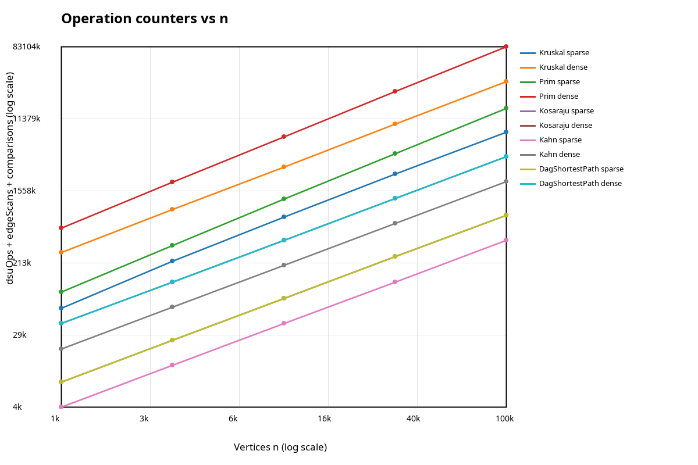
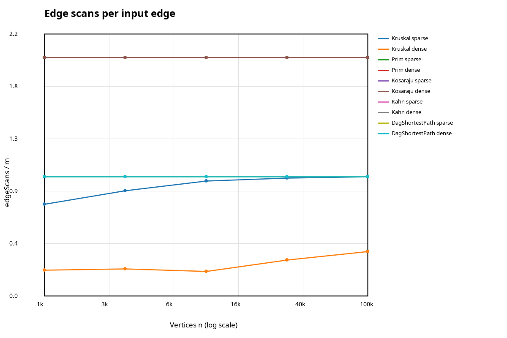
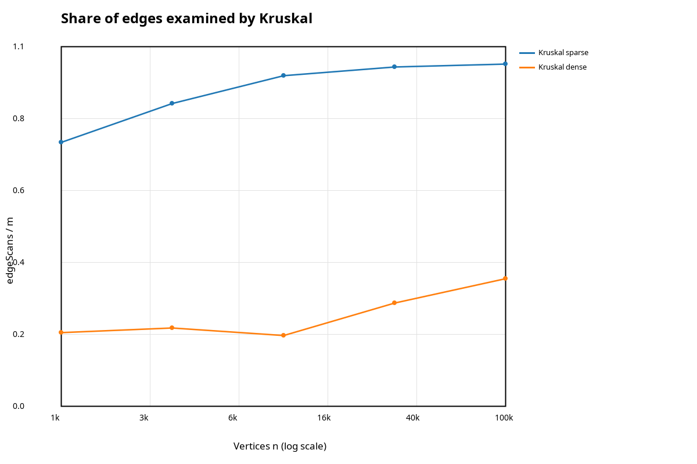

# Assignment 3 Report - Graphs: DSU, MST, SCC and Shortest Paths

## 1. Implementation overview

The project uses one weighted adjacency-list `Graph` for both directed and undirected graphs. Vertices are `0..n-1`; `Graph.read` reads the requested `n m directed|undirected` format. Edge objects are kept once in the edge list, and undirected adjacency lists point to the same edge from both endpoints. Self-loops and parallel edges are accepted. Kruskal ignores edges whose endpoints are already connected, Prim skips vertices already in the tree, and the two MST implementations return a forest on disconnected inputs.

DSU uses both union by rank and path compression. The counters are updated inside operations: each `find` invocation contributes one `dsuOps`, and every successful `union` contributes one more. `edgeScans` counts edges visited by the algorithm's traversal loop. `comparisons` counts the comparisons made by the edge sort, priority queue, or distance relaxation, as applicable. `maxDepth` records the largest explicit traversal stack used by Kosaraju. The benchmark runs each required algorithm five times and stores the median time.

## 2. Complexity table

| Operation / algorithm | Time complexity | Extra space | Reason |
|---|---|---|---|
| DSU `find` / `union` | Amortized `O(α(V))` per operation | `O(V)` total | Union by rank bounds tree height; path compression flattens paths. `α` is the inverse Ackermann function and grows extremely slowly. |
| Kruskal | `O(E log E + E α(V))`, usually `O(E log E)` | `O(V + E)` | It sorts the edge list, then uses DSU to avoid cycles. |
| Prim with a priority queue | `O((V + E) log E)` for this implementation | `O(V + E)` | Each adjacency edge is scanned and candidate edges are inserted into and removed from a heap. |
| Kosaraju | `O(V + E)` | `O(V + E)` | Two iterative DFS passes and a reversed graph each process vertices and edges a constant number of times. |
| Kahn topological order | `O(V + E)` | `O(V)` | It builds in-degrees, enqueues zero-in-degree vertices and processes every outgoing edge once. |
| Shortest paths in a DAG | `O(V + E)` | `O(V)` | It obtains a topological order and relaxes every DAG edge once while storing distance and parent arrays. |

## 3. Correctness arguments

### MST: cut property, Kruskal and Prim

A cut divides the vertices into two non-overlapping groups, and an edge crosses the cut when its endpoints are in different groups. The cut property says that a lightest edge crossing a cut is safe to include in some minimum spanning tree, provided the cut respects the edges already selected. Kruskal processes edges in nondecreasing weight order and selects an edge only when DSU says its endpoints are in different components, so it never creates a cycle. Such an edge joins two current components and is a lightest available edge between them when it is considered, so the cut property permits adding it. Prim starts with one vertex and repeatedly selects a minimum-weight edge from the current tree to a vertex outside it; that edge is the lightest edge crossing the tree-versus-not-tree cut. Both algorithms therefore make safe choices until a spanning tree is formed, and in a disconnected graph they safely form a minimum spanning forest instead. The tests compare their weights on 100 random connected graphs and check that the selected edge count is `V - 1`; a separate test checks a disconnected graph.

### DAG shortest paths: induction on topological order

A topological order puts every edge's source before its destination. Every vertex with in-degree zero is initialized to distance zero, which is equivalent to adding a virtual source with zero-weight edges to all original sources. Before processing a vertex in topological order, all of its predecessors have already been processed, so all paths that can reach that vertex have already offered their candidate distances. Relaxing its outgoing edges then propagates the best known distances to later vertices. By induction over the order, after the pass every distance is the shortest distance from the virtual source, and the parent array records a corresponding path. A DAG has no directed cycle, so a path cannot return to an earlier vertex and later improve a finalized vertex; this is why negative edge weights are safe. In a general graph, a negative cycle can make shortest paths undefined, and without a topological order one pass of relaxations is not enough.

### SCC and topological-order validation

Kosaraju's first iterative DFS records vertices in finish order. In the reversed graph, processing vertices in decreasing finish order separates strongly connected components; each discovered traversal is one component. The implementation uses explicit stacks and reports their maximum depth, so it can process a path of 100,000 vertices without relying on the JVM call stack. Kahn removes only zero-in-degree vertices and decreases the in-degree of every outgoing edge. If fewer than `V` vertices are removed, at least one directed cycle remains; otherwise its output is checked so every edge `u -> v` satisfies `pos[u] < pos[v]`. The tests cross-check Kosaraju against brute-force reachability on random graphs.

## 4. Counter checks and slope check

The table below gives the measured counter-to-formula ratios in increasing sizes `1,000 / 3,162 / 10,000 / 31,623 / 100,000`. Values come from `results/results.csv`.

| Counter and formula | Sparse ratios | Dense ratios | Interpretation |
|---|---|---|---|
| Kosaraju `edgeScans / (V + E)` | `1.60, 1.60, 1.60, 1.60, 1.60` | `1.905, 1.905, 1.905, 1.905, 1.905` | Exactly stable: Kosaraju scans `2E` edges. |
| Prim `edgeScans / E` | `2.00` at every size | `2.00` at every size | Every non-loop undirected edge is inspected from both endpoints. |
| Kahn `edgeScans / E` | `1.00` at every size | `1.00` at every size | Each DAG edge is processed once during queue traversal. |
| DAG relaxation `edgeScans / E` | `1.00` at every size | `1.00` at every size | Each DAG edge is relaxed once. |
| Kruskal `dsuOps / E` | `3.88, 4.36, 4.69, 4.79, 4.82` | `1.02, 1.08, 1.00, 1.38, 1.65` | DSU work stays within the same order of magnitude; the ratio depends on how many sorted edges are examined before the forest is complete. |
| Kruskal `edgeScans / E` | `0.770, 0.885, 0.966, 0.991, 0.999` | `0.215, 0.228, 0.207, 0.302, 0.372` | Kruskal stops when a connected MST is complete. It examines almost all sparse edges but a smaller share of dense edges. |

For the sort part of Kruskal, comparisons grow on the order of `E log E`; the measured `comparisons / (E log₂ E)` ratios are about `0.75-0.91` for sparse inputs and `0.67-0.90` for dense inputs. They remain the same order of magnitude as the graph grows. The comparison count is incremented inside the sorting comparator rather than estimated after the run.

A least-squares fit of `log₁₀(edgeScans)` against `log₁₀(V)` gives the following slopes for the five size points:

| Algorithm | Sparse slope | Dense slope |
|---|---:|---:|
| Kosaraju | 1.000 | 1.000 |
| Kahn | 1.000 | 1.000 |
| DAG shortest paths | 1.000 | 1.000 |
| Prim | 1.000 | 1.000 |
| Kruskal | 1.055 | 1.119 |

The graph traversals have slope 1.00 because their scan counts are fixed multiples of `E`, and the generator keeps `E` proportional to `V`. Kruskal's edge-scan slope is a little steeper because the number of candidates it must examine before accepting `V - 1` edges increases slowly with input size. Its full sorting comparison count provides the separate `E log E` part of the cost.

### Plots

**Operations vs n** (`dsuOps + edgeScans + comparisons`, log-log axes):

**Scans per input edge** (`edgeScans / m`):

**Share of edges Kruskal examines** (`edgeScans / m` for sparse and dense MST inputs):

## 5. Which algorithm when?

| Situation | Preferred choice | Why |
|---|---|---|
| Sparse undirected graph given as an edge list | Kruskal | Sorting the edge list is straightforward; DSU cheaply rejects cycle-forming edges. |
| Growing a tree from a start vertex using adjacency lists | Prim | The priority queue selects the next light edge from the current tree; this version naturally extends to a forest for disconnected graphs. |
| Very dense graph with an adjacency matrix | Classic matrix-based Prim | Its `O(V²)` implementation avoids sorting all `E` edges or maintaining a heap of candidate edges. The required priority-queue Prim in this project is not that matrix variant. |
| Need minimum spanning forest on a disconnected graph | Kruskal or Prim | Both report the component count and do not throw when the graph is disconnected. |
| Directed graph where cycles may exist and SCCs are needed | Kosaraju | It finds SCCs in `O(V + E)` with two iterative DFS passes and an explicit reversed graph. |
| A directed acyclic graph where an order is needed | Kahn | It produces a topological order, and an incomplete order is an explicit cycle signal. |
| Shortest paths on a DAG, including negative weights | DAG shortest paths | Topological relaxation finishes in `O(V + E)` and does not require nonnegative weights. |
| General graph with nonnegative weights | Dijkstra (not required here) | The DAG-specific one-pass method cannot be used if cycles are possible. |
| General graph with negative edges | Bellman-Ford (not required here) | It supports negative edges and detects reachable negative cycles. |

For the generated dense inputs, Kruskal examines about `21-37%` of edges while Prim scans about `2E` adjacency entries. In this implementation, Prim still has to manage a large priority queue, so its comparison count is notably higher on dense inputs. A matrix-based Prim is often attractive for genuinely dense graphs, but it would be a different implementation from the priority-queue version required by the assignment.

## 6. Timing observations

Times in the CSV are the median of five runs in the current environment and are not portable performance promises. On the 100,000-vertex sparse case, the medians were about 140 ms for Kruskal, 326 ms for Prim, 155 ms for Kosaraju, 37 ms for Kahn and 59 ms for DAG shortest paths. On the 100,000-vertex dense case they were about 448 ms, 2,105 ms, 780 ms, 150 ms and 242 ms respectively. Timing includes the work performed by each algorithm but excludes graph generation. The numbers can change with CPU, JVM, heap size, garbage collection and system load; the operation counters and reference values are the reproducible evidence used in the analysis.
